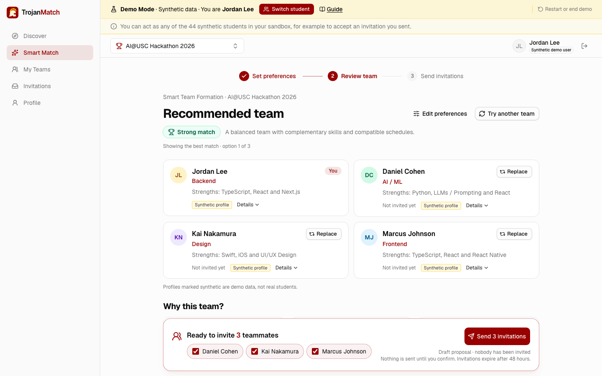
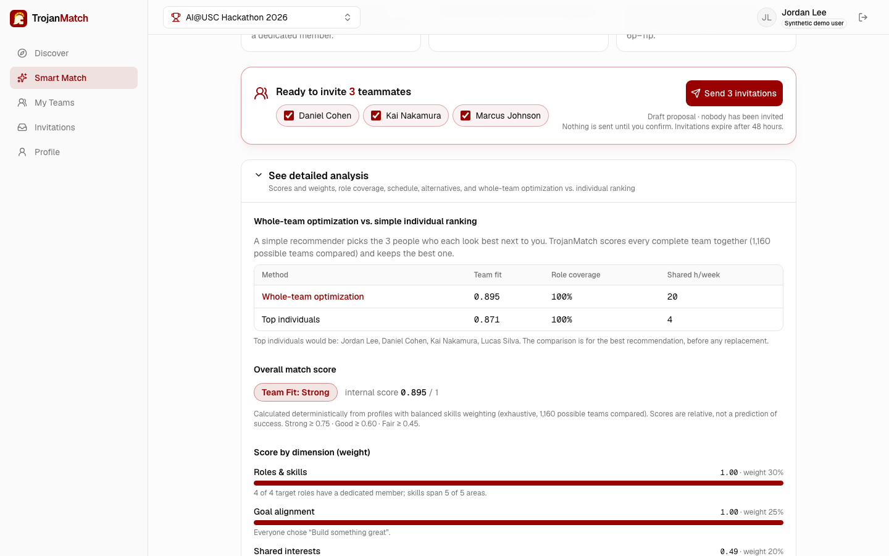
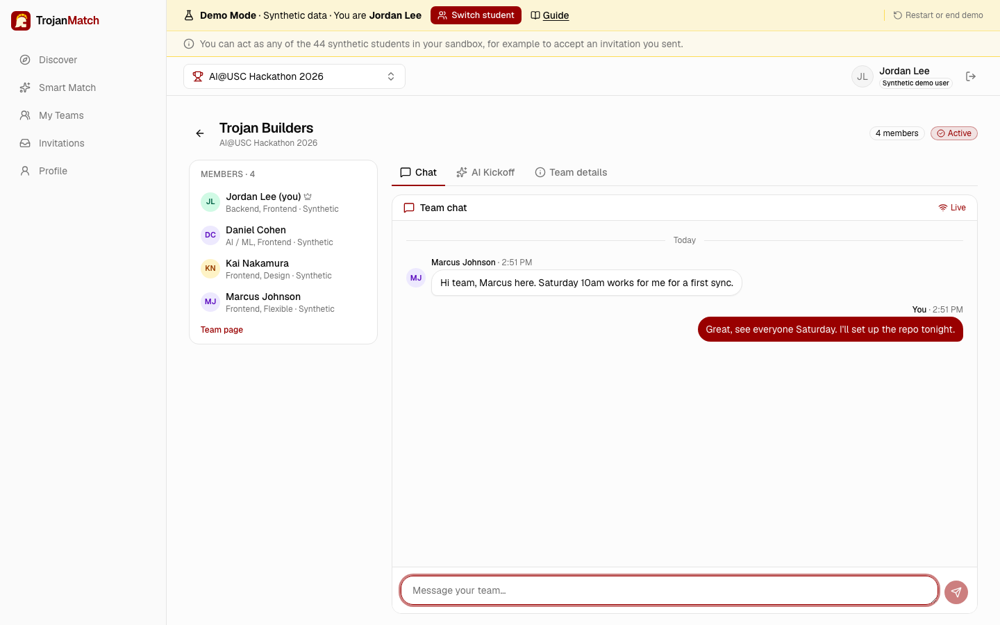
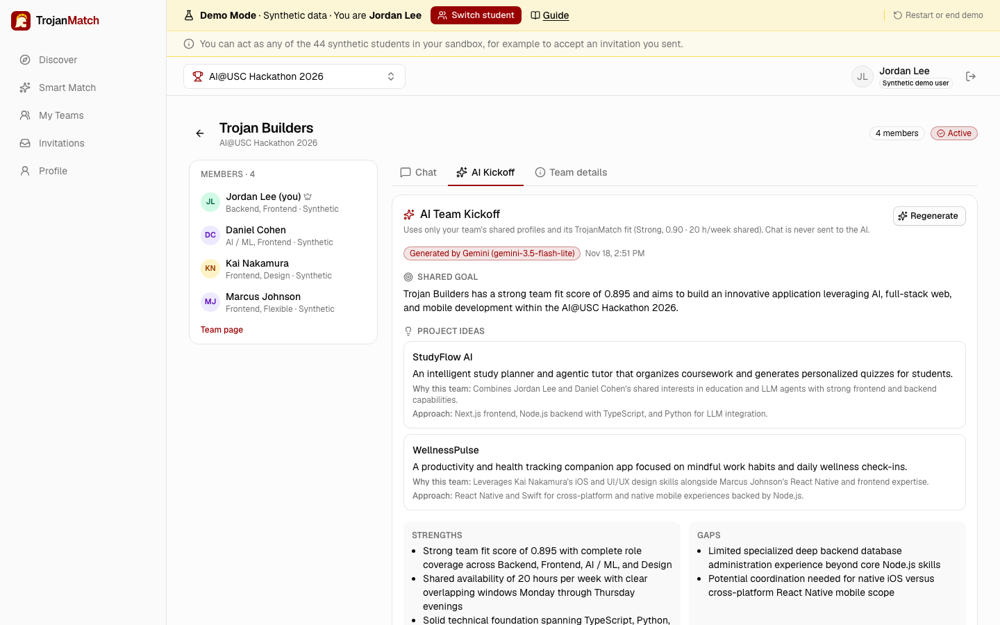
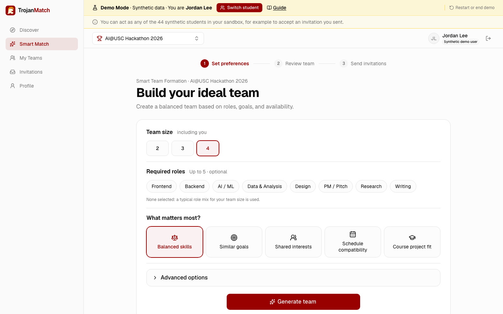
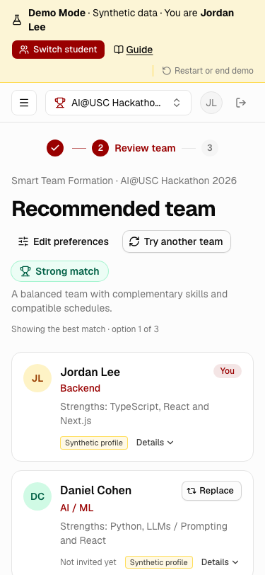
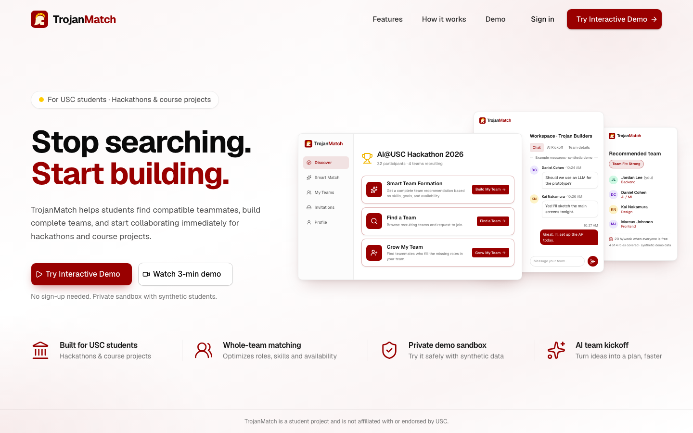
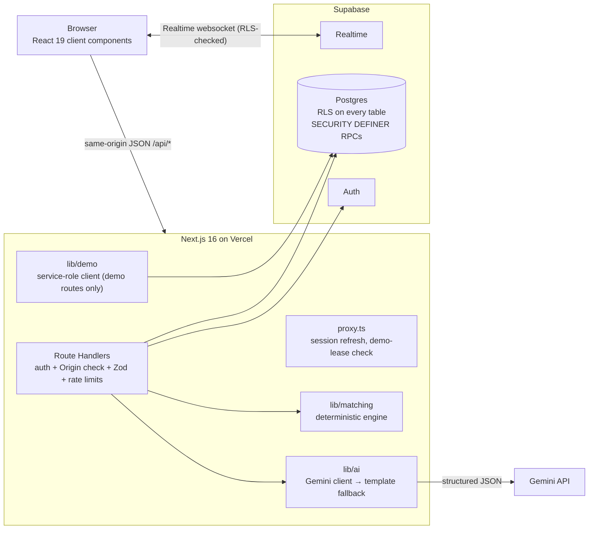

# TrojanMatch

**Whole-team matching for USC hackathons and course projects.** TrojanMatch recommends a complete,
balanced team, explains why it fits, and takes the team from invitations to a shared workspace with
real-time chat and a Gemini-generated kickoff plan.

**[Live demo →](https://trojanmatch-jade.vercel.app)** (one click, no sign-up, private sandbox with synthetic students) ·
**[3-minute video →](https://youtu.be/u0y4W5DaLL0)**



I started TrojanMatch solo at the AI@USC Hackathon 2026 (Nov 14–15) and kept refining it afterwards.
It's an independent student project, not affiliated with or endorsed by USC. All people in the demo are synthetic.

## Why whole-team matching

Most teammate finders rank *individuals*: "these are the people who look best next to you." But a team
of individually good matches can still be a bad team. Three backend developers with no shared free
time is the classic failure.

TrojanMatch scores **complete candidate teams** on five factors: role and skill coverage, goal
alignment, shared interests, availability overlap and working style. It keeps the best team, offers
structurally different alternatives, and shows the comparison against individual ranking.

In the demo's *AI@USC Hackathon 2026* Space, as *Jordan Lee* with default settings, there are 20
eligible candidates. The engine scores all 1,140 possible 4-person teams and finds one with
**20 shared hours a week**. Picking the top individuals instead gives **4**. Both cover every role.
This is one synthetic example shown in the app, not a measured result.



## Features

**Smart Team Formation, in three steps**
1. **Set preferences.** Team size, up to 5 required roles, and what matters most (balanced skills,
   similar goals, shared interests, schedule or course-project fit). Minimum shared hours and strict
   requirements sit under *Advanced options*.
2. **Review the team.** A match label (Strong, Good, Fair or Weak, derived from the score), a
   one-sentence summary, member cards and three "Why this team?" cards for skills, goals and schedule.
   When the score is good but a card flags a weakness, the label turns neutral and a note names the
   trade-offs. *Try another team* cycles through alternatives. *Replace* swaps one member and
   recomputes the whole team. If you've made a manual replacement, switching teams asks before
   discarding it. *See detailed analysis* shows the scores, weights, role coverage, schedule overlap
   and the comparison with individual ranking.
3. **Send invitations.** Choose who to invite. Nothing is sent until you confirm, and invitations
   expire after 48 hours.

Smart Team Formation also completes an *existing* team: it keeps the current members and fills the open
positions against the team's own role requirements.

**Explainable matching.** Every explanation is derived from the engine's own output (`lib/matching/why.ts`).
There are no hand-written claims and no LLM paraphrasing. Unit tests check that a positive label never
contradicts a warning card, and that required roles and desired skills are reported separately.

**Teams and invitations.** Find a Team (browse recruiting teams and request to join), Grow My Team
(candidates ranked by how much they improve your team), explicit invitations, accept/decline,
auto-activation once everyone has answered, and an owner-only *finalize*.

**Workspace with real-time chat.** Accepted members get a team workspace. Messages arrive live through
Supabase Realtime, and Row-Level Security decides who can read them.

**Gemini-powered kickoff.** One click generates a structured plan for the team: shared goal, project
ideas, strengths, gaps, suggested roles, a first-meeting agenda, first actions and risks.

| Team workspace (real-time chat) | AI Kickoff (generated by Gemini) |
|---|---|
|  |  |

| Step 1: preferences | Mobile (375px) | Landing |
|---|---|---|
|  |  |  |

## How the matching works

The engine (`lib/matching/engine.ts`) is pure TypeScript. It has no I/O and no randomness, so the same
input always gives the same team.

```
Team Fit = Σ weightᵢ · componentᵢ          (each component in [0, 1])

skill     0.7 · role coverage + 0.3 · skill score    (roles assigned one member each)
goal      mean pairwise goal compatibility
interest  mean pairwise overlap of interest tags
schedule  min(1, hours/week when EVERYONE is free ÷ target hours)
style     mean pairwise working-style compatibility
```

- **Weights come from the selected preset.** "Balanced skills" uses 0.30 / 0.25 / 0.20 / 0.15 / 0.10.
  The weights are documented heuristics, not validated predictors of team success, and the app says so.
- **Search:** build a shortlist (the top 24 candidates by individual gain, plus the best 3 per target
  role). If the number of possible teams from that shortlist is ≤ 25,000, every one is scored.
  Otherwise a width-64 beam search runs. Ties go to the higher score, then to sorted member IDs.
- **Outputs:** the best team, up to two structurally different alternatives, and the
  "top individuals" team for comparison.
- **Hard constraints live in PostgreSQL, not in the engine.** `get_match_pool` returns only people in
  the same Space and the same scope who have opted in to *all* of: visible to members, accepting
  invites, Smart Match and looking for a team. The engine never sees anyone else.

## Architecture



- **Spaces** are the unit of isolation. A Space is one hackathon edition or one course assignment.
  Search, matching, invitations and chat never cross Spaces, and Postgres enforces this, not the UI.
- **Writes go through RPCs.** Tables that hold teams, members and invitations have no direct
  insert, update or delete policies. Every write is an audited `SECURITY DEFINER` function that
  checks the caller (`auth.uid()`), scope, Space status, role, capacity and deadlines.
- **The LLM is outside the decision path.** Gemini writes the kickoff text only. It never sees
  candidates outside the team and never changes scores or recommendations.

## Tech stack

| Layer | Technology |
|---|---|
| Frontend | Next.js 16.4 (App Router), React 19, TypeScript, Tailwind CSS v4, shadcn/ui on Base UI, lucide icons |
| Backend | Next.js Route Handlers and `proxy.ts`, Zod validation |
| Database and auth | Supabase: Postgres 17 (RLS, PL/pgSQL RPCs, `pg_trgm`), Auth, Realtime |
| AI | Gemini REST API with JSON-schema output, validated with Zod (default `gemini-3.6-flash`, fallback `gemini-3.5-flash-lite`) |
| Testing | Vitest (unit and integration against local Supabase), Playwright (1440px and 375px) |
| Hosting | Vercel (app), Supabase Cloud (database) |

## Engineering challenges and solutions

**1. A public demo with no password that can't touch real data or other visitors.**
The demo is a pool of isolated sandboxes. Each slot has its own scope (`demo:<n>`) and its own
~44 synthetic students.
- A visitor leases a free slot with `demo_acquire_slot`, serialized by an advisory lock, so two
  visitors never share a sandbox. Restart and reset only touch the visitor's own slot.
- Every demo SQL function derives its scope from the slot number, so it can never produce `prod`.
  RLS and scoped RPCs keep each scope invisible to the others.
- Leases have a configurable hard limit (60 minutes by default) and free the slot after 30 minutes
  idle. The next visitor's start resets the slot to the fixture.

**2. Authentication without shared credentials.**
- Persona passwords are `HMAC(secret, email)`, derived on the server and never stored or sent to the
  browser. Persona emails use the reserved `.invalid` domain.
- The lease is an httpOnly cookie holding a random 32-byte token; the database stores only its
  SHA-256. `proxy.ts` validates the lease on every request and signs out sessions whose lease was
  replaced or expired.
- Only supported Supabase Auth APIs are used, with no direct writes to `auth.*` tables.
- In production, email confirmation is on and public sign-up stays off until custom SMTP is
  configured. The interactive demo is the way in.

**3. Authorization in the database, not just the UI.**
- All 12 public tables have RLS enabled.
- 43 `SECURITY DEFINER` functions, every one with a pinned `search_path` and schema-qualified names.
  Default `EXECUTE` is revoked, and grants are explicit per role.
- Helpers live in a `private` schema that the REST API doesn't expose. Only 2 functions
  (`search_spaces`, `get_space`) are callable without signing in.
- A catalog-level integration test fails the test suite if any of this regresses.

**4. Concurrency in team formation.**
- One team per person per Space is a partial unique index, so two simultaneous accepts can't both win.
- Invitation RPCs lock the team row (`FOR UPDATE`, in a consistent order) before checking capacity, so
  "accept" and "finalize" serialize.
- Integration tests run these races with `Promise.all`.

**5. Rate limiting and AI cost.**
- Limits are kept in a Postgres ledger (`private.api_events`): new demo sandboxes per visitor (salted
  IP hash) per hour, active sandboxes per visitor, and restarts, persona switches and simulated joins
  per sandbox.
- Gemini kickoffs are capped at 6 per team per hour. Demo sandboxes also share a budget: 4 per
  sandbox per hour and 60 across all sandboxes per day.
- Past a limit, or on a model timeout or error, the kickoff falls back to a deterministic template
  and the UI says so.
- The primary model has a configurable timeout (18 s by default, 20 s maximum), then one try on a
  faster fallback model.

**6. Reliable deployment.**
- Migrations are append-only and dry-run first (`supabase db push --dry-run`).
- Production auth settings are versioned in `supabase/config.toml` under `[remotes.production]`.
- `.vercelignore` keeps local env files out of CLI uploads.
- Each release records the previous Vercel deployment as the rollback target and runs focused
  Playwright smoke checks against production. Read-only SQL digests (`scripts/sql/prod-snapshot.sql`)
  confirm production data is unchanged.

## More than an AI wrapper

- **The core decision is an algorithm, not a prompt.** Team recommendations come from a deterministic
  optimizer with documented weights, exhaustive or beam search, and a baseline you can inspect. The
  same input always gives the same team, and you can test it.
- **Explanations are computed, not generated.** Labels, summaries and trade-off notes are derived
  from the engine's numbers and unit-tested for consistency.
- **The LLM is optional and contained.** Gemini drafts the kickoff only. It receives only the
  team's consented matching features (no emails, bios, chat or other students), its JSON is validated
  with Zod, and member references are checked against the team. If anything fails, the app still
  works and shows a template.
- **Most of the engineering is in data integrity and isolation:** RLS, RPC authorization, race-safe
  invitations, a sandboxed public demo and rate-limited AI use.

## Testing

| Suite | What it covers |
|---|---|
| Unit (Vitest, 116 tests) | Scoring and search determinism, explanation consistency, kickoff grounding and Gemini fallback, demo lease cookies and persona passwords, input validation, Origin checks |
| Integration (Vitest, 207 tests, local Supabase) | Every RPC called directly with real JWTs, RLS, scope uniqueness, invitation and finalize races, demo-pool isolation, expiry and budgets, catalog security audit |
| End-to-end (Playwright, 68 test cases at 1440px and 375px) | Full recruiter journey, Spaces, teams, chat, two simultaneous visitors, idle expiry, throttling, unauthorized access, responsive layout |

```bash
npm run lint && npm run typecheck && npm test && npm run build
npm run db:lint                                # Supabase schema linter
E2E_SPACE_TAG=<letters> npx playwright test    # use a fresh tag per run
```

## Local development

Requires Node.js, Docker (for local Supabase) and npm.

```bash
npm install
npx supabase start -x studio,edge-runtime,logflare,vector,storage-api,imgproxy,postgres-meta
cp .env.example .env.local      # fill in the values from `npx supabase status -o env`
npm run dev-users               # two confirmed dev accounts via the admin API (no email needed)
DEMO_SLOTS=4 npm run seed:demo -- --slots 1-4   # synthetic demo sandboxes (idempotent)
npm run dev
```

Set `DEMO_MODE_ENABLED=true` and a 32+ character `DEMO_PERSONA_SECRET` to use the one-click demo
locally. `GEMINI_API_KEY` is optional; without it, kickoffs use the deterministic template.
Integration tests refuse to run against anything other than local Supabase.

## Project structure

```
app/                  Next.js routes: (app) pages, (auth), /demo, /api/* route handlers
components/match/     Smart Team Formation (steps, settings, member cards, detailed analysis)
lib/matching/         engine.ts (scoring + search), service.ts, view.ts, why.ts (explanations)
lib/ai/               Gemini client and kickoff (schema, prompt, template fallback)
lib/demo/             sandbox leases, persona sign-in, service-role client
supabase/migrations/  schema, RLS, RPCs, demo pool, rate limits (append-only)
tests/                unit/, integration/, e2e/
docs/                 spec, implementation plan, public-demo design, phase handoffs
```

## Limitations

- Match weights are heuristics. They aren't validated against real team outcomes.
- The demo uses synthetic students. Public sign-up is off in production until custom SMTP is set up.
- A Space creator gets no moderation rights, and verification of events and courses is community-level only.

## Documentation

[Product spec](docs/TrojanMatch_Final_Spec.md) · [Implementation plan](docs/IMPLEMENTATION_PLAN.md) ·
[Public demo design](docs/PUBLIC_DEMO.md)
